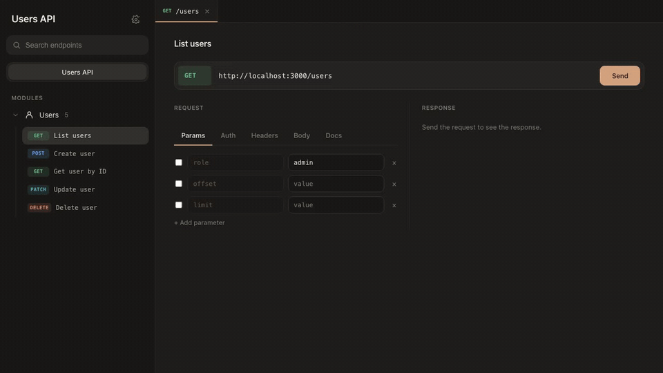
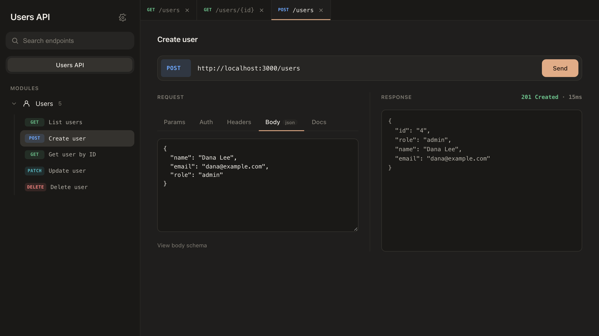
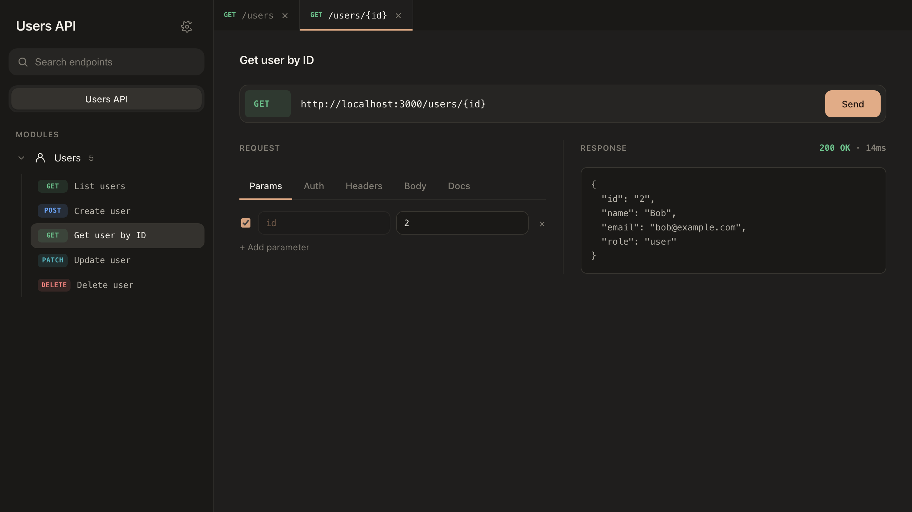

# api-catalog

[](https://www.npmjs.com/package/api-catalog)
[](https://crates.io/crates/api-catalog)
[](https://docs.rs/api-catalog)
[](https://github.com/kaysman/api-catalog/actions/workflows/ci.yml)
[](LICENSE)

**A Postman-style API console, generated from your Express, NestJS, Axum, or Actix-web routes. No spec files.**

Document each route where you define it. At startup, api-catalog builds the OpenAPI 3 document and serves an interactive console next to your API: browse endpoints, fill in params, send requests, and inspect responses.



## Quick start

```sh
npm install api-catalog
```

```ts
import express from "express";
import { ExpressApiCatalog } from "api-catalog/express";
import { s } from "api-catalog/spec";

const app = express();
const catalog = new ExpressApiCatalog(app, { title: "Users API" });

catalog.get("/users/:id", {
  summary: "Get user by ID",
  parameters: [catalog.pathParam("id", s.string())],
  responses: { 200: catalog.jsonResponse("User", s.object({ id: s.string(), name: s.string() })) },
}, (req, res) => res.json({ id: req.params.id, name: "Alice" }));

catalog.mount();     // GET /docs → console, GET /docs/default.json → OpenAPI
app.listen(3000);
```

Rust (Axum) works the same way:

```rust
let catalog = Catalog::builder()
    .title("Users API")
    .route(route!(GET "/users/:id")
        .summary("Get user by ID")
        .path_param("id", Schema::string())
        .response(200, "User", Schema::object_ref("User")))
    .build();

let app = Router::new()
    .route("/users/:id", get(get_user))
    .nest("/docs", catalog.into_axum_router());
```

## Why

- **The spec is a byproduct of the code.** Docs live next to the handler, so they can't drift into a separate YAML file nobody updates.
- **One console, two ecosystems.** The same frontend ships in the npm package and the Rust crate, and both emit standard OpenAPI 3. You can import it into Postman or Insomnia, or use it for client generation.
- **Zero runtime footprint.** No codegen step and no static files to deploy. The page is rendered once at startup (in Rust, it's embedded at compile time).
- **Safe defaults.** The NestJS adapter keeps the docs route off in production unless you opt in, and the page escapes everything it injects.

## Packages

| Ecosystem | Frameworks | Package | Docs |
|-----------|------------|---------|------|
| TypeScript / Node.js | Express, NestJS | [`api-catalog` on npm](https://www.npmjs.com/package/api-catalog) | [packages/node](packages/node/README.md) |
| Rust | Axum, Actix-web, any (`Catalog::openapi()` / `html()`) | [`api-catalog` on crates.io](https://crates.io/crates/api-catalog) | [packages/rust](packages/rust/README.md) · [docs.rs](https://docs.rs/api-catalog) |

NestJS gets its own decorators (`@ApiOperation`, `@ApiParam`, `@ApiResponse`, …), and `@nestjs/swagger` isn't required. See the [Node.js README](packages/node/README.md#nestjs).

## Examples

Both examples serve the same Users API. Run either one and open <http://localhost:3000/docs>.

```sh
# NestJS
cd examples/nestjs && npm install && npm start

# Axum
cargo run -p api-catalog-example-axum
```

<details>
<summary>More screenshots</summary>




</details>

## How it works

```
your routes + inline docs ──► SpecBuilder ──► OpenAPI 3 document ──► GET /docs/default.json
                                                     │
                       ui/ (HTML, CSS, JS) ──────────┴──────────────► GET /docs  (console)
```

- Each adapter collects route docs into a `SpecBuilder`. NestJS reads decorator metadata from the module graph; Express and Rust use builder calls.
- Framework-style paths are normalised to OpenAPI templates: `/users/:id`, `*rest`, and `{id:\d+}` all become `/users/{id}`.
- The console is plain JS with no build step. It fetches the document and renders the endpoint tree, request editor (params, auth, headers, body), and response viewer. Auth tokens and `{{variables}}` persist per scope in `localStorage`.

## Repository layout

```
api-catalog/
├── ui/                     ← console frontend (CSS + JS), the single source of truth
├── packages/
│   ├── node/               ← npm package (Express + NestJS adapters), vitest suite
│   └── rust/               ← Rust crate (Axum + Actix-web), unit + integration tests
├── examples/
│   ├── nestjs/
│   └── axum/
├── scripts/
│   ├── build-ui.mjs        ← syncs ui/ into both packages
│   └── capture.mjs         ← regenerates the README screenshots and GIF
└── .github/workflows/      ← CI (Node 18/20/22 + Rust) and tag-triggered release
```

## Development

```sh
npm ci                     # install workspace deps
npm run build:ui           # after editing ui/: sync it into both packages
npm run lint && npm test   # Node: type-check + vitest
cargo test --workspace --all-features
cargo clippy --workspace --all-features --all-targets -- -D warnings
```

CI fails if `ui/` and the copies in the packages drift apart (`npm run check:ui`).

### Releasing

Bump `version` in `packages/node/package.json` and `packages/rust/Cargo.toml`, add a `CHANGELOG.md` entry, then push a tag:

```sh
git tag v0.1.0 && git push origin v0.1.0
```

The [release workflow](.github/workflows/release.yml) reruns CI, checks the tag against both versions, publishes to npm (with provenance) and crates.io, and creates the GitHub Release.

## License

[MIT](LICENSE)
